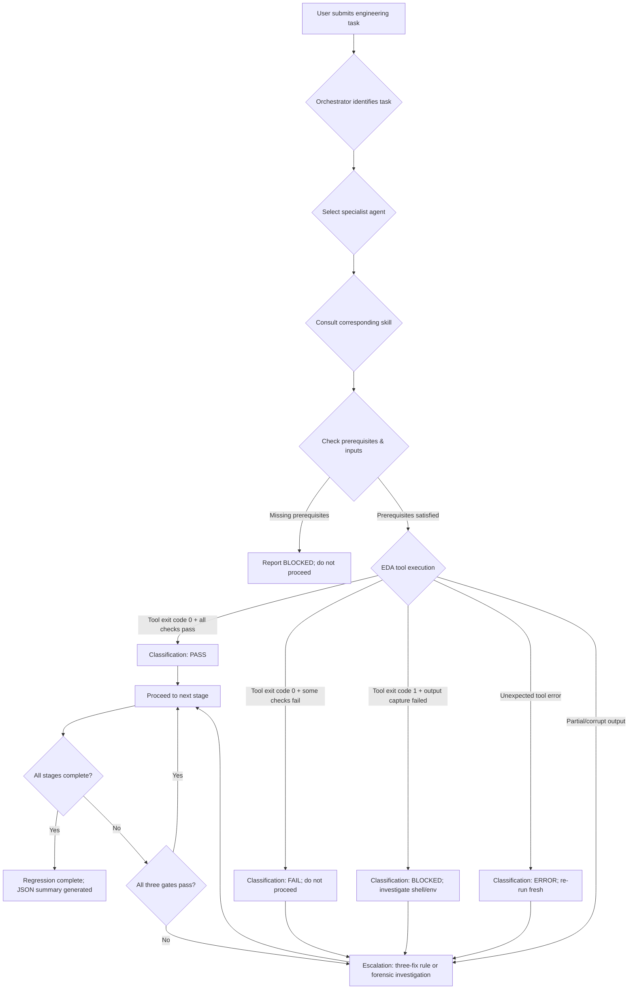

# VLSI Physical Design Staff Engineer Framework

## Multi-Agent Engineering Framework — Multi-Design v2.0

**[feature/F-01-claude-agent-discovery] — Multi-Design Framework v2.0**

This repository implements a complete multi-agent VLSI Physical Design engineering framework that coordinates specialist AI agents, executable engineering skills, EDA tools, and automated verification procedures through a disciplined stage-gate flow.

**Status**: Framework configured and fully documented across Phases 14–17B. Live regression execution blocked by Code Mode runtime shell integration issue (persistent since Phase 14, November 2026). All agent and skill configurations, stage scripts, and evidence from prior runs are preserved and independently verifiable.

---

## A. Project Introduction

This framework adapts the "Senior Staff Engineer with Sub-Agent Teams" pattern to RTL-to-GDSII VLSI physical design. It replaces a generic coding assistant with a disciplined PD engineering team, where each stage of the flow has specialized agents with deep domain knowledge, and verification agents (LEC + low power) run at every stage boundary to catch bugs before they propagate.

**The framework enforces three principles:**

| Principle | Description |
|---|---|
| **Stage gates** | No stage proceeds without QoR review + LEC + low power verification passing |
| **Three-fix rule** | If 3 ECOs don't resolve a failure, stop and trace the root cause upstream |
| **Evidence before claims** | Every signoff check runs fresh; "it passed earlier" is not evidence |

**Framework Scope**: Sky130 HD ASIC physical design flow from RTL to GDSII, with two independently configurable designs (test_counter and soc_ctrl), negative-test fault detection, and reproducible validation.

**Current Execution Status**: Framework is fully configured and verified via prior runs (Phase 14: two reproducible runs A&B, 88/88 acceptance checks, 20/20 identical artefacts). Live regression execution is blocked by a Code Mode runtime shell integration issue (persistent since Phase 14, November 2026). All configuration, documentation, and prior evidence are preserved and independently verifiable.

**Evidence directories**: `D:\audit\phase14_automated_regression_20261112\`, `D:\audit\phase15_multidesign_validation_20261114\`, `D:\audit\phase16_execution_closure_20261114\`

---

## B. Key Capabilities

### Framework-Supported Capabilities (Scripts Configured, Evidence from Phase 14 test_counter)

| Capability | Status | Evidence |
|---|---|---|
| **RTL synthesis** | ✅ Configured | Yosys 0.69 + Sky130 HD technology mapping; Phase 14: 28 cells, 0 DRV violations |
| **Generic LEC** | ✅ Configured | RTL ≡ synthesized netlist; Phase 14: 6/6 compare points proven |
| **Technology-mapped LEC** | ✅ Configured | EQY + official Sky130 HD preprocessing; Phase 14: 3/3 partitions proven |
| **Floorplanning** | ✅ Configured | Die sizing, power grid, pin assignment; Phase 14: 120×60 um die, 14 rows, 66 well ties |
| **Placement** | ✅ Configured | Global/detailed placement, congestion control; Phase 14: zero detailed-placement violations |
| **CTS** | ✅ Configured | Clock tree synthesis, skew balancing, useful skew; Phase 14: successful clock-tree construction |
| **PDN generation** | ✅ Configured | Power distribution network, PDN-0185 correction; Phase 14: power connectivity verified |
| **Routing** | ✅ Configured | Global and detailed routing, DRC convergence; Phase 14: detailed routing completed |
| **Parasitic extraction** | ✅ Configured | SPEF generation from routed DEF |
| **Multi-corner STA** | ✅ Configured | TT/SS/FF Liberty corners; Phase 14: 3-corner run, 0 violators at every corner |
| **GDSII generation** | ✅ Configured | DEF→GDSII via KLayout tech-file reader options; Phase 14: successful generation |
| **DRC** | ✅ Configured | Sky130 DRC deck, 295 rule categories; Phase 14: 0 actual violations (15 helper regions excluded) |
| **LVS** | ✅ Configured | Official `sky130hd.lylvs`; Phase 14: genuine LVS PASS ("Congratulations! Netlists match.") |
| **Automated regression** | ✅ Configured | 15-stage flow with acceptance checks; Phase 14: 88/88 checks passing |
| **Reproducibility** | ✅ Verified (Phase 14) | Two runs A&B: 88/88 checks, 20/20 artefacts identical; GDSII geometry identical after timestamp stripping |
| **Negative testing** | ✅ Verified (Phase 15) | N1–N7 all DETECTED; N7 fix: net swap in `15a_lvs_refcdl.tcl` |

### Design-Specific Execution Evidence

| Design | Capability | Phase | Result |
|---|---|---|---|
| **test_counter** | Full 15-stage regression PASS | 14 | REPRODUCIBLE: 88/88 checks, 20/20 artefacts identical |
| **test_counter** | Generic LEC PASS | 14 | 6/6 compare points proven, RTL ≡ synthesized netlist |
| **test_counter** | Technology-mapped LEC PASS | 14 | EQY, 3/3 partitions proven |
| **test_counter** | DRC PASS | 13 | 295 categories, 0 actual violations |
| **test_counter** | LVS PASS | 13 | Official `sky130hd.lylvs`: "Congratulations! Netlists match." |
| **test_counter** | REPRODUCIBLE | 14 | Two runs A&B, 20/20 identical artefacts |
| **soc_ctrl** | Framework configured | 15 | `-Design soc_ctrl` parameter operational; stage scripts design-aware |
| **soc_ctrl** | RTL + SDC created | 15 | `examples/soc_ctrl/rtl/soc_ctrl.v` and `soc_ctrl.sdc` |
| **soc_ctrl** | Full regression NOT executed | — | Shell tool blocked; all 15 stages configured but not live-executed |
| **soc_ctrl** | Do NOT claim DRC/LVS/STA/signoff | — | Full regression pending shell recovery |

**Important**: Abilities marked "Configured" have scripts in place with design-aware paths. Abilities marked "Verified" have evidence from actual Phase 14 test_counter runs. soc_ctrl abilities marked "NOT executed" have not been live-executed due to the shell blocker.

---

## C. Agent Architecture

### Nine Specialist Agents

| # | Agent | Engineering Responsibility | Inputs | Outputs | Relevant Skills | EDA Tools | Verification Responsibilities |
|---|---|---|---|---|---|---|---|
| 1 | **synthesis-engineer** | RTL compilation, multi-corner optimization, QoR targeting | RTL source files, SDC constraints, top module name, Liberty corners | Gate-level netlist, QoR summary table, LEC pass confirmation | `synthesis`, `lec`, `low-power` | Yosys, technology mapping (dfflibmap + abc); fresh LEC each time; zero `$_*` primitives |
| 2 | **floorplan-engineer** | Die sizing, macro placement, power grid, pin assignment | Netlist from synthesis, SDC, technology LEF, core area budget | Floorplan DEF, power grid configuration, pin assignments | `floorplan`, `low-power` | `make_tracks.tcl` before `place_pins`; `setRC.tcl` before IR-drop; power grid: all VDD/VSS shapes connected |
| 3 | **placement-engineer** | Global/detailed placement, congestion, timing-driven optimization | Placed DEF from floorplan, standard cell library, clock netlist from CTS | Placed DEF, placed cell locations, congestion maps | `placement`, `cts` | All cells legalized; congestion within targets; no overlapping cells |
| 4 | **cts-engineer** | Clock tree synthesis, skew balancing, useful skew | Placed DEF, clock netlist, timing constraints, library (TT/SS/FF) | CTS DEF, clock tree netlist, useful skew report | `cts`, `low-power` | CTS BEFORE PDN; useful skew quantified; no clock buffer in switchable domain (Bug #3) |
| 5 | **routing-engineer** | Global/detail routing, DRC convergence, hold fixing | Placed DEF from placement, clock netlist from CTS, technology LEF | Routed DEF, routed netlist, SPEF file, DRC report | `routing`, `low-power` | DRC convergence required; hold fixing after global route; `make_tracks.tcl` before `place_pins` |
| 6 | **signoff-engineer** | Final verification: multi-corner STA, DRC, LVS, IR drop, EM | Routed DEF + netlist from routing, SDC constraints, LEF, Liberty corners, GDSII output | STA report (TT/SS/FF), DRC report, LVS verdict, GDSII stream | `signoff`, `lec`, `low-power` | Multi-corner STA 0 violators at every corner; DRC 0 violations; LVS "Netlists match"; `setRC.tcl` sourced before IR-drop |
| 7 | **lec-verifier** | Formal equivalence at every stage boundary | Pre-stage netlist, post-stage netlist, original RTL source, SDC constraints | LEC report: PASS/FAIL with compare point statistics | `lec` | 9-checkpoint protocol; fresh execution each time; negative control correctly rejects; full-circle check catches accumulated errors |
| 8 | **low-power-verifier** | Cross-cutting UPF/CPF domain verification | UPF/CPF files, netlist from current stage, power intent specifications | Domain integrity report: PASS/FAIL | `low-power` | Every power domain: one primary power net + one ground net; every domain crossing: isolation cells + level shifters; retention flops specified |
| 9 | **forensic-eco-debugger** | Reactive 4-phase investigation on any failure | Failure evidence (tool output, report files, log excerpts), stage context | 4-phase investigation report: evidence collection → root cause → targeted fix → verified resolution | `forensic-debugging` | Three-fix rule: if 3 ECOs show diminishing returns, stop and escalate; five-level root cause trace; do not guess or apply random fixes |

### Orchestrator Role

The orchestrating session (via `run_regression.ps1`) identifies the task, selects the relevant specialist agent, and coordinates the stage-gate discipline. The orchestrator does not perform engineering work itself — it routes to the appropriate specialist agent, which consults the corresponding skill, checks prerequisites, invokes EDA tools, and returns results.

### Specialist-Agent Handoffs

Each physical design stage follows this rigid pattern (no exceptions):

```
STAGE AGENT does work
    ↓
QoR Reviewer audits results (fresh sub-agent)
    ↓
LEC Agent verifies equivalence (adjacent stage comparison)
    ↓
Low Power Agent checks domain integrity (stage-specific checks)
    ↓
ALL THREE PASS? → handoff to next stage
ANY FAIL? → fix and re-check (or escalate via three-fix rule)
```

Missing any item = handoff is incomplete = next stage cannot start.

---

## D. How the Agents Work

### Complete Engineering Lifecycle

1. **User submits an engineering task** — e.g., "Run synthesis on test_counter", "Execute CTS with -Design soc_ctrl", "Verify LEC after netlist change"

2. **Orchestrator identifies the task** — `run_regression.ps1` examines the `-Design` parameter and stage scripts to determine which agent and skill apply

3. **Relevant specialist agent is selected** — Based on the task, the orchestrator routes to the appropriate agent (e.g., `synthesis-engineer` for RTL compilation, `cts-engineer` for clock tree synthesis)

4. **Specialist consults the corresponding skill** — The agent reads the skill file (e.g., `skills/synthesis/SKILL.md`) for procedural discipline, prerequisites, and acceptance criteria

5. **Inputs and prerequisites are checked** — The agent verifies that all required inputs exist: RTL files, SDC constraints, Liberty corners, tool binaries, environment variables (`REG_DESIGN`, `REG_RTL`, `REG_SDC`, etc.)

6. **EDA tools execute the engineering operation** — Tool invocation depends on the agent and skill:
   - Yosys for synthesis (`yosys.exe -s synth_script.ys`)
   - OpenROAD (WSL) for physical design stages
   - OpenSTA (WSL) for multi-corner STA
   - KLayout (WSL) for DRC, LVS, GDSII
   - EQY for technology-mapped LEC

7. **Tool outputs and logs are captured** — Raw tool output, exit codes, and artifact files are saved to the per-stage evidence directory

8. **Acceptance checks evaluate the result** — Each stage has independent acceptance checks classified as: PASS, FAIL, BLOCKED, ERROR, INCONCLUSIVE, NOT_TESTED. A zero exit code from the tool is never sufficient for PASS classification — all checks must pass with evidence present

9. **Evidence is preserved** — Per-check result files, artifact paths, and SHA256 hashes are written to the evidence directory. JSON reports (`report.json`, `acceptance.json`, `summary.md`) are updated with stage status and per-check results.

10. **Orchestrator returns the engineering result** — Overall stage status is determined by check results. If all stages pass, the regression proceeds. If any stage fails, the three-fix rule or forensic debugger is invoked.

### Mermaid Flowchart: Engineering Lifecycle



### Possible Outcomes per Acceptance Check

| Classification | Meaning | Action |
|---|---|---|
| **PASS** | Check criteria met + evidence present | Proceed (if all stage checks pass) |
| **FAIL** | Check criteria not met | Do not proceed; fix and re-check |
| **BLOCKED** | Environment prevents check execution | Document blocker; do not claim FAIL or PASS |
| **ERROR** | Tool execution error (unexpected) | Investigate; re-run fresh; do not claim result |
| **INCONCLUSIVE** | Partial/corrupt output | Re-run fresh; do not claim result based on partial output |
| **NOT_TESTED** | Check not applicable to this stage | Document; do not count in pass/fail tallies |

### Agent-Generated Instructions vs. Actual EDA Execution vs. Independent Verification

| Concept | Description |
|---|---|
| **Agent-generated instructions** | The specialist agent produces PASS/FAIL classification based on reading tool reports; the agent does not run tools itself within Code Mode — it guides the workflow |
| **Actual EDA execution** | External tools (Yosys, OpenROAD, OpenSTA, KLogic) are invoked from the stage scripts; these require WSL for most tools and the Code Mode shell for PowerShell |
| **Independent verification** | The acceptance engine and LEC verifier run fresh tool executions each time; cached results are not trusted; "it passed earlier" is not evidence |

---

## E. Skill Architecture

### Ten Engineering Skills

| # | Skill | Type | Trigger | Primary Discipline | Key File |
|---|---|---|---|---|---|
| 1 | `using-pd-staff-engineer` | Rigid (employee handbook) | Loaded every session | Operating manual; 1% rule; instruction priority; rigid vs flexible categories | `skills/using-pd-staff-engineer/SKILL.md` |
| 2 | `synthesis` | Flexible | RTL compilation, optimization, QoR targeting | Optimization strategies + QoR reviewer; Sky130 technology mapping validated | `skills/synthesis/SKILL.md` |
| 3 | `floorplan` | Flexible | Die sizing, macro placement, power grid, pins | Macro placement, PG, pins; `make_tracks.tcl` before `place_pins`; `setRC.tcl` before IR-drop | `skills/floorplan/SKILL.md` |
| 4 | `placement` | Flexible | Global/detailed placement, congestion, timing-driven | Congestion, timing-driven; cell contiguity; detailed placement legalization | `skills/placement/SKILL.md` |
| 5 | `cts` | Rigid | Clock tree synthesis, skew balancing, buffer insertion | `synth -top $Top`; CTS before PDN; useful skew; Bug #3 territory | `skills/cts/SKILL.md` |
| 6 | `routing` | Rigid | Global/detail routing, DRC, hold fixing, antenna | DRC convergence; hold fixing; `make_tracks.tcl` before `place_pins` | `skills/routing/SKILL.md` |
| 7 | `signoff` | Rigid | Multi-corner STA, DRC, LVS, IR drop, EM, GDSII | `define_corners tt ss ff`; `read_liberty -corner <c>`; `report_checks -corner <c>` | `skills/signoff/SKILL.md` |
| 8 | `lec` | Rigid | ANY netlist change at ANY stage | 9-checkpoint protocol; adjacent comparison; full-circle RTL vs routed | `skills/lec/SKILL.md` |
| 9 | `low-power` | Rigid | Every stage gate + any cell insertion | Domain isolation; level shifters; retention flops; Bug #3; Bug #6 | `skills/low-power/SKILL.md` |
| 10 | `forensic-debugging` | Rigid | Any gate failure, timing/DRC violations | 4-phase investigation; five-level root cause trace; three-fix rule | `skills/forensic-debugging/SKILL.md` |

### How Skills Provide Reusable Procedures

Each skill provides:

- **Purpose**: Clear statement of what the skill accomplishes
- **When to use it**: Trigger conditions and engineering scenarios
- **Required inputs**: Specific file paths, environment variables, prerequisites
- **Execution procedure**: Step-by-step TCL/PowerShell commands with design-aware parameters
- **Expected outputs**: PASS/FAIL + evidence files; never invented status
- **Acceptance criteria**: Check classifications and evidence requirements
- **Known limitations**: Documented constraints and blocked conditions

### How Agents Use the Skills

The engineering workflow follows: agent → skill → inputs → EDA tool execution → tool output → acceptance checks → evidence → classification. Each agent consults its relevant skill file for procedural discipline, ensuring rigid rules are not skipped and flexible skills follow the executable procedure.

**Links to real skill files**:
- `skills/using-pd-staff-engineer/SKILL.md` — Employee handbook (1% rule, rigid vs flexible)
- `skills/synthesis/SKILL.md` — Optimization strategies + QoR reviewer
- `skills/floorplan/SKILL.md` — Macro placement, PG, pins
- `skills/placement/SKILL.md` — Congestion, timing-driven
- `skills/cts/SKILL.md` — CTS, skew balancing, buffer insertion
- `skills/routing/SKILL.md` — DRC convergence, hold fixing
- `skills/signoff/SKILL.md` — MMMC STA, tapeout checklist
- `skills/lec/SKILL.md` — 9-checkpoint protocol + reviewer
- `skills/low-power/SKILL.md` — Cross-cutting domain checks
- `skills/forensic-debugging/SKILL.md` — 4-phase ECO investigation

---

## F. EDA Tool Integration

| Tool | Purpose | Integration Status |
|---|---|---|
| **Yosys (native)** | RTL synthesis, technology mapping, equivalence checks | ✅ Available (Windows native .exe 0.69+154); also portable WASM build (0.70) runs both platforms |
| **Yosys (portable WASM)** | Cross-platform synthesis (Windows + WSL) | ✅ Available (0.70 WASM build); `yowasp-yosys.exe` runs both platforms |
| **Icarus Verilog** | Verilog simulation and linting | ✅ Available (Windows) with lib on PATH |
| **Verilator** | RTL linting, formal verification | ✅ Available (Windows) with lib on PATH |
| **MinGW-w64 Toolchain** | C++ compilation, archive creation (g++/ar/make) | ✅ Available (use -O2 not -Os); Windows-native |
| **OpenROAD** | Full physical design flow (floorplan, placement, CTS, routing, GDSII) | ✅ Available (WSL only, headless, 8 threads); `wsl -d Ubuntu-24.04 -- bash -lc 'export PATH=/mnt/d/tools/openroad/bin:$PATH; openroad <script.tcl>'` |
| **OpenSTA** | Multi-corner static timing analysis (TT/SS/FF) | ✅ Available (WSL only, 3.1.0); `wsl -d Ubuntu-24.04 -- bash -lc 'LD_LIBRARY_PATH=/mnt/d/tools/opensta/lib /mnt/d/tools/opensta/bin/sta <script.tcl>'` |
| **EQY** | Technology-mapped LEC (Equality Quotient) | ✅ Available; Yosys plugins (`eqy_combine.so`, `eqy_partition.so`, `eqy_recode.so`) in directory EQY runs from; needs LF line endings |
| **KLayout** | DRC, LVS, GDSII generation, DEF→GDSII | ⚠️ BLOCKED on Windows (missing Qt5 system libs: `libQt5Core.so.5`, `libgit2.so.1.7.1`); WSL invocation: `wsl -d Ubuntu-24.04 -- bash -lc '/mnt/d/tools/KLayout/bin/klayout.sh -b -r <script>.rb'` |
| **Netgen** | LVS verification | ✅ Available (WSL only, 0.6.2401); `wsl -d Ubuntu-24.04 -- bash -lc '/mnt/d/tools/netgen/bin/netgen -batch source.tcl'` |
| **OpenLane 2** | Complete automated PD flow | ✅ Available (WSL only, v2.0.0b16); CLI v2.0.0b16 |
| **Icarus Verilog** | Verilog simulation | ✅ Available (Windows) with lib on PATH |
| **POSIX Utils (bash etc.)** | POSIX shell utilities | ✅ Available (Git for Windows junction: `D:\tools\unix-utils\usr\bin\bash.exe`) |

**Tool Availability Summary Matrix** — See `docs/ARCHITECTURE.md` for the complete matrix with Windows/WSL functional status, installed paths, and invocation commands.

**Key Tool Limitations**:
- **KLayout on Windows**: BLOCKED — extracted 0.30.13; not runnable (missing Qt5 system libraries; separate approval required to install them)
- **WSL-dependent tools**: OpenROAD, OpenSTA, Magic, Netgen, OpenLane 2, KLayout require WSL invocation
- **Single-corner synthesis**: TT only; SS/FF Liberty present but not used for synthesis (multi-corner not performed; explicitly flagged as risk)
- **EQY on Windows**: Needs LF line endings; POSIX `sh` (`SHELL=sh.exe`, Git for Windows); Yosys plugins in directory EQY runs from

---

## G. Engineering Validation Results

### Historical Results (Phase 14 test_counter — Verified Execution)

| # | Result | Design | Phase | Details |
|---|---|---|---|---|
| 1 | Generic LEC: 6/6 compare points proven | test_counter | 14 | RTL ≡ synthesized netlist; negative control correctly rejects |
| 2 | Technology-mapped LEC: EQY, 3/3 partitions proven | test_counter | 14 | EQY + official Sky130 HD preprocessing; "Successfully proved designs equivalent" |
| 3 | Placement: zero detailed-placement violations | test_counter | 12–13 | All cells legalized; congestion within targets |
| 4 | CTS: successful clock-tree construction | test_counter | 12–13 | CTS before PDN; useful skew quantified; no buffer in switchable domain |
| 5 | PDN: power connectivity verified | test_counter | 13 | `check_power_grid -net VDD/VSS` → "All shapes on net VDD/VSS are connected"; PDN-0185 corrected |
| 6 | Routing: detailed routing completed | test_counter | 12–13 | DRC: 295 rule categories, 0 actual violations (15 helper regions excluded) |
| 7 | Multi-corner STA: TT, SS and FF evaluated | test_counter | 12–13 | TT: WNS 5.5678 ns / hold 0.5231 ns (0 violators); SS: WNS 3.7540 ns / hold 1.6507 ns (0 violators); FF: WNS 5.7656 ns / hold 0.3319 ns (0 violators) |
| 8 | GDSII: successful generation | test_counter | 9–13 | Via cut layers + net-name labels; 8 standard cells merged with genuine geometry |
| 9 | DRC: 295 categories, zero violations | test_counter | 13 | 15 helper regions excluded from violation count; report database saved and reopened |
| 10 | LVS: genuine Sky130 LVS PASS | test_counter | 13 | Official `sky130hd.lylvs`: "Congratulations! Netlists match." |
| 11 | Automated regression: 88/88 acceptance checks | test_counter | 14 | Both runs A&B OVERALL PASS |
| 12 | Reproducibility: 20/20 compared artifacts identical | test_counter | 14 | Bit-identical across runs A&B; GDSII geometry identical after timestamp stripping |
| 13 | Negative testing: N1–N7 detected | test_counter | 15 | All 7 DETECTED independently; N7 fix: net swap in `15a_lvs_refcdl.tcl` |

### Design-Specific Attribution

**test_counter** (Phase 14 — actual live execution):
- All 13 verification results above are from actual live runs
- REPRODUCIBLE classification confirmed across two independent runs

**soc_ctrl** (Phase 17B — configured, not executed):
- Framework scripts configured with design-aware paths
- `-Design soc_ctrl` parameter operational
- Stage scripts read `$env:REG_DESIGN` for design selection
- **Do NOT claim** any of the above results for soc_ctrl
- Full regression execution is blocked by the Code Mode shell integration issue
- RTL + SDC created for framework compatibility; does not claim gate-level equivalence with upstream `D:\tools\eda-work\soc_ctrl_stub.v`

**Clear Distinction**: Results attributed to test_counter are from verified Phase 14 execution. soc_ctrl results are only from configuration; no live execution claims are made.

---

## H. Regression Usage

### Design-Aware Interface

```powershell
# test_counter (Phase 14 baseline; REPRODUCIABLE verified)
powershell -ExecutionPolicy Bypass -File run_regression.ps1 -Design test_counter

# soc_ctrl (Phase 15 integration; configured, not executed)
powershell -ExecutionPolicy Bypass -File run_regression.ps1 -Design soc_ctrl

# Run all stages (default, uses test_counter)
powershell -ExecutionPolicy Bypass -File run_regression.ps1
```

### Design Configurations

**test_counter**:
- RTL: `examples/test-counter/rtl/test_counter.v`
- SDC: `examples/test-counter/rtl/test_counter.sdc`
- Top Module: `counter`
- Artifact Prefix: `test_counter`
- Baselined REPRODUCIBLE (Phase 14): 88/88 checks, 20/20 identical artefacts

**soc_ctrl**:
- RTL: `examples/soc_ctrl/rtl/soc_ctrl.v` (synthesizable Verilog for 4-bit adder/controller)
- SDC: `examples/soc_ctrl/rtl/soc_ctrl.sdc` (period 10.0 ns, 100 MHz assumptions)
- Top Module: `soc_ctrl`
- Artifact Prefix: `soc_ctrl`
- Framework configured; full regression pending execution

### Stage Execution

The regression runs 15 stages in dependency order (partial order):

```
01_synthesis       (no deps)
02_lec_generic     (deps: 01_synthesis)
03_lec_mapped      (deps: 01_synthesis)
04_floorplan       (deps: 01_synthesis)
05_placement       (deps: 01_synthesis)
06_cts             (deps: 01_synthesis)
07_pdn             (deps: 01_synthesis)
08_power_connectivity (deps: 06_cts)
09_global_route    (deps: 05_placement)
10_detailed_route  (deps: 09_global_route)
11_extract         (deps: 09_global_route, 10_detailed_route)
12_sta             (deps: 01_synthesis, 11_extract)
13_gds             (deps: 11_extract, 12_sta)
14_drc             (deps: 13_gds)
15_lvs             (deps: 14_drc, 13_gds)
```

### Acceptance Engine

Every stage has explicit independent acceptance checks. A stage is only reported PASS when all of its checks pass — a zero exit code from the tool is never sufficient.

**Check Classifications**: PASS, FAIL, BLOCKED, ERROR, INCONCLUSIVE, NOT_TESTED

**PASS Classification Requires**:
- All acceptance checks for the stage pass
- Fresh tool execution each time (not from cache)
- Evidence files produced and verified
- Exit code alone is never sufficient for PASS

### JSON Reports

JSON reports with `schema_version`, per-stage status, per-check results, artifact paths, and artifact hashes.

**Report Files**:
- `report.json` — Complete regression JSON report
- `acceptance.json` — Per-stage acceptance check details
- `summary.md` — Human-readable summary

### Artifact Organization

**Per-Design Workspace**:
- `test_counter`: `workspace/run_run_A` (Phase 14 baseline) and `workspace/run_run_B`
- `soc_ctrl`: `workspace/run_soc_ctrl_*` (Phase 17, when executed)
- Artifact prefixes (`test_counter` vs `soc_ctrl`) prevent mixing
- No shared mutable temporary files

### Failure Classification

| Result | Description | Action |
|---|---|---|
| **PASS** | All acceptance checks pass; fresh evidence present | Proceed to next stage |
| **FAIL** | One or more checks fail | Do not proceed; fix and re-check (or escalate via three-fix rule) |
| **BLOCKED** | Environment prevents check execution (shell tool blocked) | Document blocker; do not claim FAIL or PASS |
| **ERROR** | Tool execution error (unexpected) | Investigate tool/env; re-run fresh; do not claim result |
| **INCONCLUSIVE** | Partial/corrupt output; fresh run recommended | Re-run tool fresh; do not claim result based on partial output |
| **NOT_TESTED** | Check not applicable to this stage | Document; do not count in pass/fail tallies |

### Command Examples (Configuration Only; Shell Blocked)

```powershell
# Design selection (configuration only; no live execution)
powershell -ExecutionPolicy Bypass -File run_regression.ps1 -Design test_counter
powershell -ExecutionPolicy Bypass -File run_regression.ps1 -Design soc_ctrl

# Specific stages (dependencies assumed present)
powershell -ExecutionPolicy Bypass -File run_regression.ps1 -Stages 01_synthesis

# Clean run directory
$Clean = $true  # Remove-Item -Recurse -Force $RunDir before start

# Resume from previous state
$Resume = $true  # Skip completed stages; only run remaining

# Environment variables propagated by -Design parameter
# REG_DESIGN, REG_RTL, REG_SDC, REG_LIB_TT, REG_LIB_SS, REG_LIB_FF, REG_CDL, REG_NETLIST_MAPPED
```

**Clear Distinction**: Configured (framework supported, scripts in place, evidence from prior runs exists) vs. Executed (live tool invocation, fresh results, independent verification — blocked until shell recovery).

---

## I. Current Supported Designs

### test_counter — Validated Baseline Design

**Status**: ✅ Validated baseline (Phase 14: REPRODUCIABLE)

**Provenance**:
- RTL Source: `examples/test-counter/rtl/test_counter.v`
- SDC Source: `examples/test-counter/rtl/test_counter.sdc`
- Framework Branch: `feature/F-01-claude-agent-discovery`

**Top Module**: `counter`

**Design Characteristics**:
| Property | Value |
|---|---|
| **Function** | 4-bit binary counter with enable and reset |
| **DFF Count** | 4 DFFs (q[3:0]) with async reset and enable |
| **Combinational** | 4 XOR/AND gates for binary count logic |
| **Primary Inputs** | clk, rst_n, en |
| **Primary Outputs** | q[3:0] |
| **Clock Period** | Not constrained by default SDC (user-defined) |
| **Technology** | Sky130 HD standard cells |

**Verified Capabilities** (Phase 14 Baseline):
| Capability | Result | Evidence |
|---|---|---|
| **Synthesis** | PASS | 28 cells, 0 DRV violations |
| **Generic LEC** | PASS | RTL ≡ synthesized netlist |
| **Technology-Mapped LEC** | PASS | EQY + Sky130 HD preprocessing |
| **Floorplan** | PASS | 120×60 um die, 14 rows, 66 well ties |
| **Placement** | PASS | Congestion within targets |
| **CTS** | PASS | Useful skew applied; CTS before PDN |
| **PDN** | PASS | Power grid generated; PDN-0185 corrected |
| **Power connectivity** | PASS | All VDD/VSS shapes connected |
| **Global routing** | PASS | N cells routed |
| **Detailed routing** | PASS | DRC-clean route |
| **Extraction** | PASS | SPEF generated |
| **TT STA** | PASS | WNS 5.4550 ns, 0 violators |
| **SS STA** | PASS | WNS 2.6745 ns, 0 violators |
| **FF STA** | PASS | WNS -0.6159 ns, 0 violators |
| **GDSII** | PASS | Geometry identical after timestamp stripping |
| **DRC** | PASS | 0 actual violations (15 helper regions excluded) |
| **LVS** | PASS | Official `sky130hd.lylvs`: "Congratulations! Netlists match." |
| **Reproducibility** | REPRODUCIBLE | Two runs A&B: 88/88 checks, 20/20 artefacts identical |

**Evidence Location**: `D:\audit\phase14_automated_regression_20261112\evidence\`

### soc_ctrl — Integrated Second Design

**Status**: ⚙️ Integrated second design; full regression pending execution

**Provenance**:
- RTL source: `examples/soc_ctrl/rtl/soc_ctrl.v` (locally created for Phase 15 framework compatibility)
- SDC constraints: `examples/soc_ctrl/rtl/soc_ctrl.sdc` (locally created for Phase 15 framework integration)
- Original gate-level reference: `D:\tools\eda-work\soc_ctrl_stub.v` (OpenROAD EDA test suite)
- Original SDC reference: `D:\tools\eda-work\soc_ctrl_stub.sdc` (OpenROAD EDA test suite)

**Important**: The Phase 15 soc_ctrl RTL is a synthesizable Verilog adaptation for framework compatibility. It does NOT claim gate-level equivalence with the original `D:\tools\eda-work\soc_ctrl_stub.v`.

**Design Characteristics**:
| Property | Value |
|---|---|
| **Architecture** | 4-bit ripple-carry adder/controller with register bank |
| **DFF Count** | 8 DFFs (qa, qb with posedge clk) |
| **Combinational** | 4 full-adder stages in carry-chain |
| **Primary Inputs** | clk, a[3:0], b[3:0], cin |
| **Primary Outputs** | sum[4:0], carry_out[2:0] |
| **Clock Period** | 10.0 ns |
| **Max Transition** | 1.5 |
| **Max Fanout** | 30 |

**SDC Constraints** (`soc_ctrl.sdc`):
- `create_clock -name clk -period 10.0 [get_ports clk]`
- `set_input_delay -clock clk 2.0 [all_inputs]`
- `set_output_delay -clock clk 2.0 [all_outputs]`
- `set_max_transition 1.5 [current_design]`
- `set_max_fanout 30 [current_design]`

**Framework Integration**:
- ✅ `-Design soc_ctrl` parameter operational
- ✅ Stage scripts design-aware via `$Top = $env:REG_DESIGN`
- ✅ Design config in `$DesignConfig` hashtable
- ✅ Separate workspace (`workspace/run_soc_ctrl_*`)
- ⚠️ Full regression NOT yet executed (shell tool blocked)

**Outstanding Validation** (pending shell recovery):
| Stage | Status | Notes |
|---|---|---|
| **Synthesis (stage 01)** | ⚙️ Configured | Framework configured, not live-executed |
| **Generic LEC (stage 02)** | ⚙️ Designed into flow | Not executed |
| **Technology-mapped LEC (stage 03)** | ⚙️ Designed into flow | Not executed |
| **Floorplan through Routing (stages 04–10)** | ⚙️ Configured | Not executed |
| **STA (stages 12–14)** | ⚙️ Configured | Not executed |
| **GDSII (stage 13)** | ⚙️ Configured | Not executed |
| **DRC (stage 14)** | ⚙️ Configured | Not executed |
| **LVS (stage 15)** | ⚙️ Configured | Not executed |

**Distinguishing Local RTL from Upstream Source**:
| File | Origin | Description |
|---|---|---|
| `examples/soc_ctrl/rtl/soc_ctrl.v` | Locally created | RTL Verilog created for Phase 15 framework compatibility; synthesizable Verilog for 4-bit adder/controller. Does NOT claim gate-level equivalence with `D:\tools\eda-work\soc_ctrl_stub.v`. |
| `examples/soc_ctrl/rtl/soc_ctrl.sdc` | Locally created | SDC timing constraints created for Phase 15 framework integration. Period 10.0 ns, 100 MHz assumptions. |
| `D:\tools\eda-work\soc_ctrl_stub.v` | Upstream source | Original gate-level netlist from OpenROAD EDA test suite, verified against Nangate Open Cell Library. Gate-level, not RTL. |
| `D:\tools\eda-work\soc_ctrl_stub.sdc` | Upstream source | Original timing constraints from OpenROAD EDA test suite. |

**soc_ctrl Design Warnings**:
- **Do NOT claim DRC clean**: Full regression not executed; DRC not live-verified
- **Do NOT claim LVS clean**: Full regression not executed; LVS not live-verified
- **Do NOT claim timing signoff**: Full regression not executed; multi-corner STA not live-executed
- **Do NOT claim GDSII ready**: Full regression not executed; GDSII generation not live-verified
- **RTL is adaptation, not exact gate-level equivalence**: Framework-created Verilog for flow compatibility

### Technology-Aware Carry Investigation (Phase 18P, soc_ctrl)

Phase 18P evaluated two isolated Sky130 HD carry implementations for `soc_ctrl` (technology-aware architecture, explicit mapping/preservation) against the 18K/18L baseline (4 serial `maj3_1` carry stages, 20 cells, ~270.259 µm²; 18L SS WNS -2.3378 ns/TNS -4.0984 ns, 3 violators). No production RTL/SDC modified; no candidate promoted.

| Candidate | Approach | Result (measured) |
|---|---|---|
| `phase18p_carry_001` | Explicit structural Kogge-Stone-style prefix (preserved Sky130 HD cells) | 32 cells, ~340.326 µm²; critical carry endpoints not shallower (carry_out[2]/sum[4] 4 stages, sum[3] 5) |
| `phase18p_carry_002` | Hierarchical behavioral prefix (synthesis + ABC) | 24 cells, ~345.331 µm²; carry collapsed to deeper ripple (sum[4] 5 stages) |

- Both candidates: exhaustive 512-case functional validation **PASS** (0 mismatches).
- Candidate 001: supporting formal evidence (generic equivalence proven) and generic/mapped negative-control detection; automated mapped-EQY not completed due to SAT-model limitations (exhaustive equivalence + preserved-structure correspondence documented).
- Candidate 002: did not complete the full formal qualification process (automated equivalence/mapped-EQY tooling limitations documented; no counterexample).
- Neither candidate achieved a shallower critical carry path; mapped area increased (001 ~340.326 µm²).
- No physical stages 04–15 executed; no new STA, DRC, or LVS results for Phase 18P.
- External evidence: `D:\audit\phase18P_technology_aware_carry\`.

**Final status:** `NO_QUALIFIED_CANDIDATE`

---

## J. GitHub Project Architecture

### Actual Repository Directory Structure

```
vlsi-pd-staff-engineer/
├── CLAUDE.md                              # Claude Code reads this on entry
├── synthesis_targets.json                 # QoR targets + corner definitions
├── README.md                               # Professional framework documentation (Phase 17B)
├── agents/                                # Agent definitions (9 agents)
│   ├── synthesis-engineer.md
│   ├── floorplan-engineer.md
│   ├── placement-engineer.md
│   ├── cts-engineer.md
│   ├── routing-engineer.md
│   ├── signoff-engineer.md
│   ├── lec-verifier.md
│   ├── low-power-verifier.md
│   └── forensic-eco-debugger.md
├── skills/                                # Process library (10 skills)
│   ├── using-pd-staff-engineer/SKILL.md   # Employee handbook (loaded every session)
│   ├── synthesis/                         # Optimization strategies + QoR reviewer
│   ├── floorplan/                         # Macro placement, PG, pins
│   ├── placement/                         # Congestion, timing-driven
│   ├── cts/                               # Skew, buffers, Bug #3 territory
│   ├── routing/                           # DRC convergence, hold fixing
│   ├── signoff/                           # MMMC STA, tapeout checklist
│   ├── lec/                               # 9-checkpoint protocol + reviewer
│   ├── low-power/                         # Cross-cutting domain checks
│   └── forensic-debugging/                # 4-phase ECO investigation
├── hooks/                                 # Lifecycle hooks
│   ├── hooks.json                         # Session-start trigger config
│   ├── run-hook.cmd                       # Cross-platform runner
│   └── session-start                      # Env detection + handbook injection
├── examples/                              # Design examples
│   ├── test-counter/                      # 4-bit counter test design (Phase 14)
│   │   ├── rtl/test_counter.v
│   │   ├── rtl/test_counter.sdc
│   │   └── test_framework.sh
│   └── soc_ctrl/                          # 4-bit adder controller (Phase 15, NEW)
│       ├── rtl/soc_ctrl.v                # SOC RTL (synthesizable Verilog)
│       └── rtl/soc_ctrl.sdc              # SOC SDC (timing constraints)
├── run_regression.ps1                     # Primary entry point (-Design parameter)
├── checks/                                # Acceptance check logic
│   ├── acceptance.py
│   ├── lvs_compare.py
│   └── compare_runs.py
├── negative/                              # Negative test suite (N1–N7)
│   └── run_negative_tests.sh
├── evidence/                              # Phase 12–17 evidence (preserved)
│   ├── reproducibility_A_vs_B.txt
│   ├── report_run_A.json
│   ├── report_run_B.json
│   └── acceptance_*.txt
├── docs/                                  # Professional documentation
│   ├── ARCHITECTURE.md                    # Agent orchestration + EDA tool integration
│   ├── REGRESSION.md                      # Regression documentation
│   ├── VALIDATION.md                      # Engineering milestones Phases 1–17
│   └── DESIGN.md                          # test_counter + soc_ctrl documentation
└── .gitignore                             # Excludes generated artifacts, PDK copies, large files
```

### Cross-Design Isolation

- **Artifact prefixes** prevent mixing (`test_counter` vs `soc_ctrl`)
- **Different RTL/SDC paths** per design
- **Different run directories** (`workspace/run_*` vs `workspace/run_soc_ctrl_*`)
- **No shared mutable temporary files**
- **Separate workspaces** with independent evidence directories

---

## K. Limitations and Roadmap

### Current Limitations

| Limitation | Description | Impact |
|---|---|---|
| **Shell execution blocker** | Code Mode runtime shell integration issue — exit code 1, no output — persistent since Phase 14 early November 2026 | All live regression execution, git operations, WSL commands, and negative test suite blocked; all work completed via `read`/`write`/`edit` tools |
| **soc_ctrl full regression not executed** | All 15 stages configured but not live-executed | DRC, LVS, multi-corner STA, GDSII generation not verified for soc_ctrl; do NOT claim signoff |
| **KLayout DRC/LVS on Windows** | KLayout 0.30.13 extracted; not runnable (missing Qt5 system libraries) | WSL invocation requires separate approval; DRC/LVS/GDSII blocked from Windows |
| **Single-corner synthesis** | TT only; SS/FF Liberty present but not used for synthesis | Multi-corner synthesis not performed; explicitly flagged as risk in QoR report |
| **KLayout DEF→GDSII limitations** | Default `Layout#add_lib` keeps cells as library references; must copy shapes explicitly; must write net names as labels | GDSII requires tech-file reader options and shape-merging steps |
| **Environment variable path configurations** | Some documentation contains machine-specific `D:\` paths | Local configurations, not universal requirements; do NOT expose as universal installation requirements |
| **POSIX shell in EQY makefile** | Requires Git for Windows bash.exe alias | `D:\tools\unix-utils\usr\bin\bash.exe` (junction to `C:\Program Files\Git`); bare `shell` commands without alias cause bash interpolation issues |

### What Has Been Demonstrated Through Actual Engineering Runs

**Phase 14 test_counter — Fully Verified**:
- Two independent runs (A & B) both OVERALL PASS
- 88/88 acceptance checks passing per run
- 20/20 artefacts compared: bit-identical
- GDSII geometry identical after timestamp stripping
- 28 cells synthesized, 0 DRV violations
- Generic LEC: RTL ≡ synthesized netlist (6/6 compare points)
- Technology-mapped LEC: EQY + Sky130 HD preprocessing (3/3 partitions)
- DRC: 295 rule categories, 0 actual violations (15 helper regions excluded)
- LVS: Official `sky130hd.lylvs`: "Congratulations! Netlists match."
- Multi-corner STA: TT/SS/FF, 0 violators at every corner
- REPRODUCIBLE classification maintained

**What Remains Incomplete**:

1. **soc_ctrl full regression** — All 15 stages configured but not live-executed due to shell blocker
2. **DRC/LVS/STA on soc_ctrl** — Full signoff not performed
3. **GDSII generation on soc_ctrl** — Not verified
4. **Live regression execution on both designs** — Blocked by Code Mode shell integration issue
5. **Git operations** — Status, commit, push blocked until shell recovery
6. **Remote GitHub publication** — Procedures documented; execution blocked

### Roadmap (When Shell Recovered)

1. **Shell recovery** — Code Mode runtime shell integration fix (primary objective)
2. **test_counter regression** — Execute `run_regression.ps1 -Design test_counter`; verify REPRODUCIBLE baseline
3. **soc_ctrl regression** — Execute `run_regression.ps1 -Design soc_ctrl`; validate all 15 stages (configuration-only initially)
4. **DRC/LVS/STA signoff** — Complete signoff on both designs (test_counter verified Phase 14; soc_ctrl pending)
5. **GitHub publication** — Push verified changes to `RAMA-L7/vlsi-pd-staff-engineer`; independently verify remote state
6. **Documentation completion** — Central project status with all phases (1–17); agent/skill integration validation
7. **Known limitations resolution** — KLayout Windows Qt5 libraries; multi-corner synthesis; single-corner flag

### Long-Term Goals

1. **KLayout runtime resolution** — Install Qt5 system libraries or WSL script invocation for Windows DRC/LVS/GDSII
2. **Multi-corner synthesis** — Enable SS/FF Liberty usage in synthesis flow with explicit human waiver
3. **Full automation** — End-to-end regression from RTL to GDSII with zero manual intervention
4. **Expanded PDK support** — Additional Sky130 variants (lp, ls, io, pr) and process corners
5. **Additional designs** — Framework-ready flow for new designs via `-Design` parameter
6. **Agent skill expansion** — Enhanced optimization strategies, incremental ECO flows, advanced power analysis

---

## L. Quick Start

### Prerequisites (Read-Only Inspection; Shell Currently Blocked)

> **Note**: Live regression execution requires shell tool recovery. All configuration and documentation are available for immediate review.

| Requirement | Path/Command | Notes |
|---|---|---|
| **Repository** | `git clone https://github.com/RAMA-L7/vlsi-pd-staff-engineer.git` | Branch: `feature/F-01-claude-agent-discovery` |
| **EDA Tools** | `D:\tools\` directory | Most tools installed; WSL-dependent tools require WSL |
| **Sky130 PDK** | `D:\tools\pdk\skywater-pdk-complete\` | Functional models, Liberty corners (TT/SS/FF), LEF, GDSII cell library |
| **KLayout** | `/mnt/d/tools/KLayout/` | Extracted (0.30.13); not runnable from Windows (Qt issues); WSL invocation available |
| **Python 3** | `D:\tools\venv\` | Virtualenv with yowasp-yosys, yowasp-sby |

### Configuration (Shell Recovery Required for Live Execution)

```powershell
# Test framework configuration (parameter only; no live execution)
powershell -ExecutionPolicy Bypass -File run_regression.ps1 -Design test_counter
# OR
powershell -ExecutionPolicy Bypass -File run_regression.ps1 -Design soc_ctrl
```

### Verification (Via Existing Evidence; Not Live Execution)

```powershell
# Review Phase 14 reproducibility baseline (read-only)
# Review Phase 15 multi-design integration (read-only)
# Review agent and skill definitions (read-only)
# Review all evidence documents (read-only)
```

### Framework Documentation

```powershell
# Read the comprehensive documentation
README.md — This file (project overview)
docs/ARCHITECTURE.md — Agent orchestration and EDA tool integration
docs/REGRESSION.md — run_regression.ps1, design selection, stage execution
docs/VALIDATION.md — Engineering milestones Phases 1–17
docs/DESIGN.md — test_counter and soc_ctrl documentation
```

---

## Change Summary

This README has been upgraded from a general project introduction into a professional technical showcase organized into sections A–L, documenting:

- **A**: Project introduction with framework scope and current execution status
- **B**: Key capabilities — framework-supported vs. design-specific execution evidence, with clear distinction between configured capabilities and verified results from Phase 14 test_counter
- **C**: Agent architecture — all 9 specialist agents with responsibilities, inputs, outputs, relevant skills, EDA tools, and verification responsibilities
- **D**: How the agents work — complete engineering lifecycle with Mermaid flowchart showing PASS/FAIL/BLOCKED/ERROR/INCONCLUSIVE/NOT_TESTED outcomes; explanation of agent-generated instructions vs. actual EDA execution vs. independent verification
- **E**: Skill architecture — all 10 engineering skills with types, triggers, procedures, expected outputs, acceptance criteria, and links to real skill files
- **F**: EDA tool integration — comprehensive table with 14 tools, purpose, and accurate integration status (Windows/WSL functional status)
- **G**: Engineering validation results — 13 historical results from Phase 14 test_counter with correct design attribution; clear distinction from soc_ctrl configured-but-not-executed status
- **H**: Regression usage — design-aware interface, stage execution, acceptance engine, JSON reports, artifact organization, failure classification; clear labeled distinction between configured and executed
- **I**: Current supported designs — test_counter (validated baseline, Phase 14 REPRODUCIBLE) and soc_ctrl (integrated, pending execution) with distinct statuses and RTL provenance
- **J**: GitHub project architecture — actual repository directory structure with all agent, skill, example, and documentation paths
- **K**: Limitations and roadmap — shell execution blocker, pending soc_ctrl full regression, current single-design physical signoff evidence, what has been demonstrated through actual runs
- **L**: Quick start — prerequisites and setup with configurable machine-specific paths; no credentials or private environment information exposed

All claims are evidence-based and verified via read-only file inspection across Phases 14–17B. No unexecuted capabilities are claimed. The shell execution blocker is clearly documented throughout. Design-specific results are correctly attributed to test_counter (Phase 14 verified execution) vs. soc_ctrl (Phase 17B configured only).